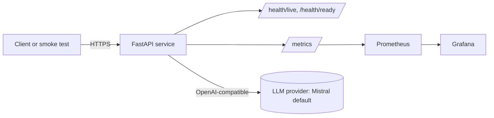

# Architecture

> Phase repos replace this page with their own system. Keep the three views and the C4 page.

## Purpose

State in two sentences what the system does, for whom, and the business outcome it changes.

## Views

| View | Question it answers | Source |
| --- | --- | --- |
| Enterprise | Which business capability, actors and value stream does this serve? (TOGAF business and application layers, ArchiMate-style) | [enterprise.mmd](../../diagrams/source/enterprise.mmd) |
| Logical | Which components exist and how does data flow between them, independent of technology? | [logical.mmd](../../diagrams/source/logical.mmd) |
| Technical | What runs where: containers, pods, managed services, networks, secrets, telemetry? | [technical.mmd](../../diagrams/source/technical.mmd) |
| C4 | Context, container and component levels | [C4.md](C4.md) |

## Template system

## Quality attributes

| Attribute | Target in the template | How it is checked |
| --- | --- | --- |
| Availability | 2 replicas, PodDisruptionBudget, readiness probes (cloud and base) | kind e2e, rollout status |
| Security | Non-root, read-only root filesystem, dropped capabilities, no service-account token, secrets out of Git | Trivy, gitleaks, manifest review |
| Portability | Same image on three desktops, three clouds, Kubernetes and OpenShift | e2e and manifests workflows |
| Observability | Request count and latency histograms, alert rules, Grafana dashboard | Compose `observability` profile |
| Cost | Scale to zero on Azure and GCP; one small Fargate task on AWS; budgets at USD 50 per cloud | Budget alerts, `docs/COST-TCO.md` |

## Decisions

See [ADRs](../adr/). Template decisions: [ADR-001 structure](../adr/ADR-001-template-structure.md), [ADR-002 provider abstraction](../adr/ADR-002-llm-provider-abstraction.md), [ADR-003 deployment matrix](../adr/ADR-003-deployment-matrix.md).
