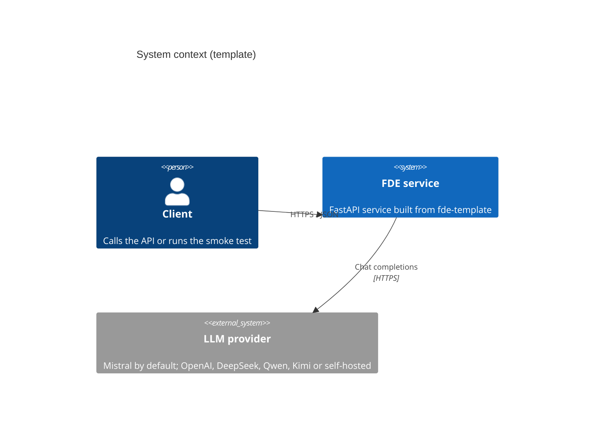
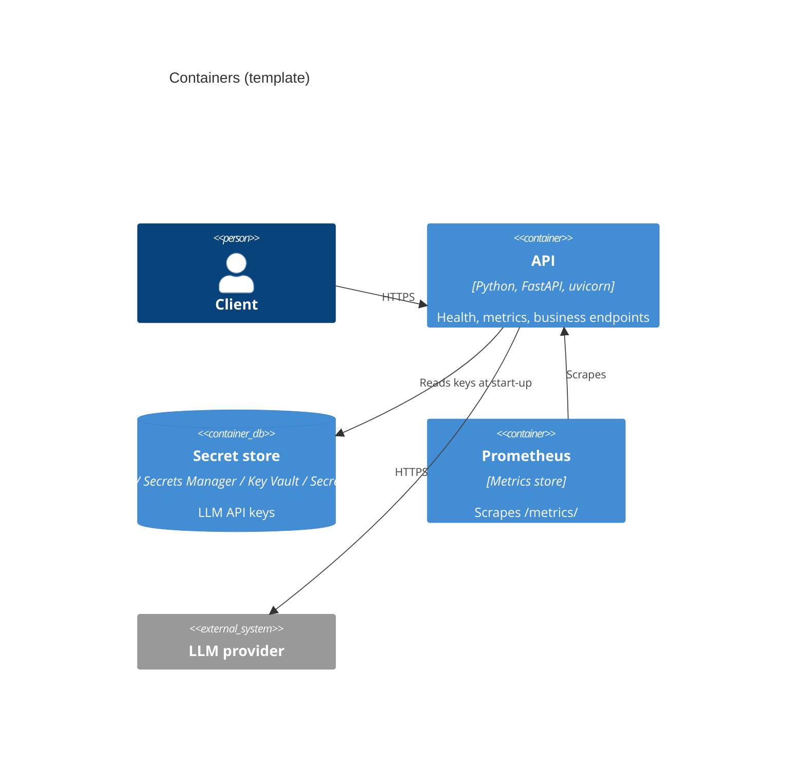

# C4 views

> Phase repos replace these diagrams with their own system at each level.

## Level 1: System context

## Level 2: Containers

## Level 3: Components (API)

| Component | Module | Responsibility |
| --- | --- | --- |
| HTTP layer | `app/main.py` | Routing, validation (Pydantic), metrics middleware |
| Settings | `src/fde_service/config.py` | Environment-driven configuration |
| LLM client | `src/fde_service/llm.py` | Provider selection, model per role, data-residency guard |
